# Royal Vault

A premium 1920s art deco slot game built in Unity 6: black lacquer and champagne gold, faceted gems, a jewelled
crown jackpot and Egyptian revival details. Five reels, three rows, 20 paylines, scatter free spins with a
multiplier, three progressive jackpots, and a full presentation layer (reel physics, win lines, BIG / MEGA / EPIC
celebrations, coin showers). A 3 x 3 classic machine ships alongside it on the same code and art.

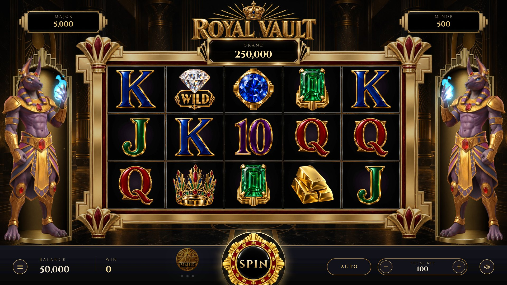

| Loading | Big win | Free spins |
|---|---|---|
| 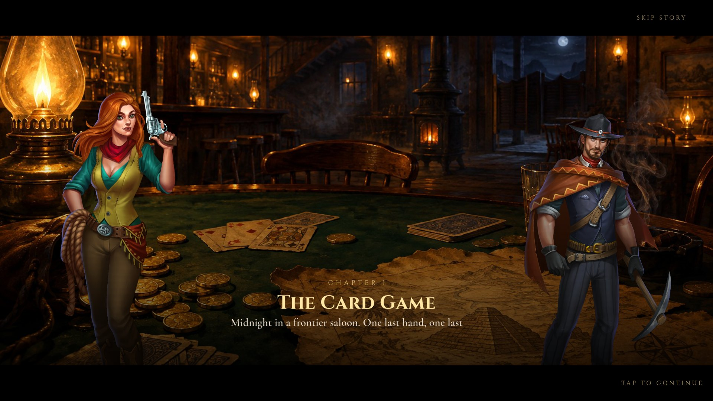 | 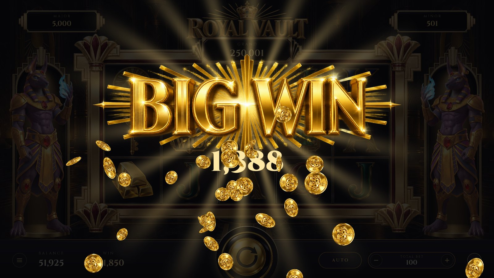 | 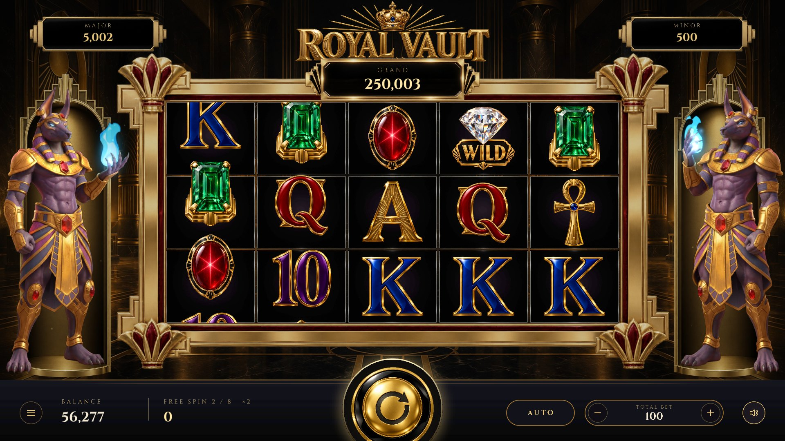 |
| **Win lines** | **Pay table** | **Classic 3 x 3** |
| 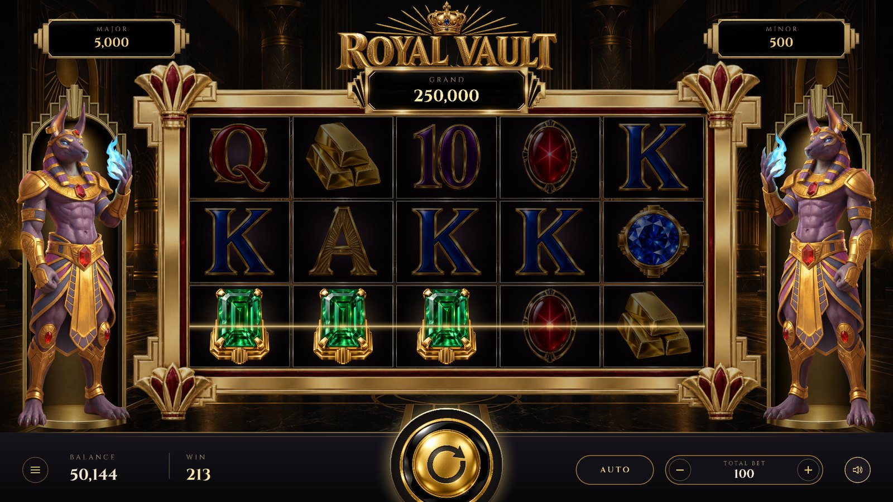 | 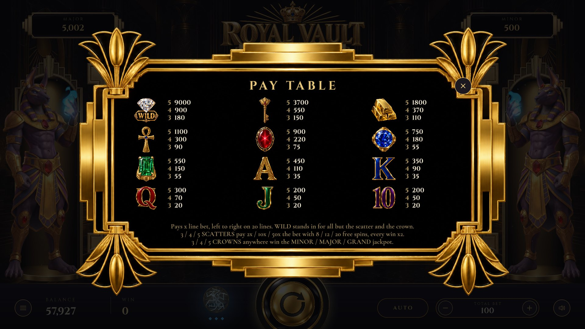 | 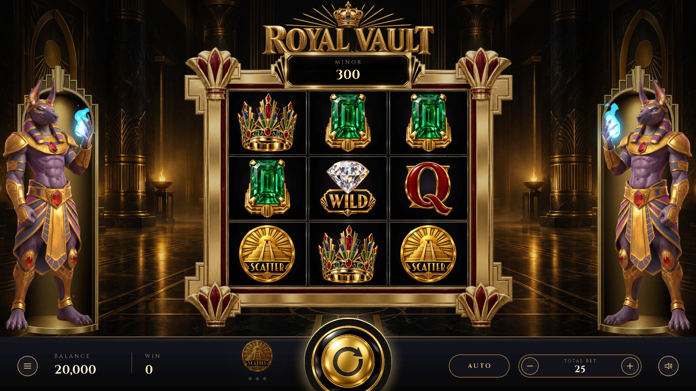 |

The guardians are animated: they idle with a blue flame in the hand and, on big wins and now and then on their own,
lower the hand and call the flame up again. Their skeletal animation is baked offline to frames (a `CharacterAnimation`
ScriptableObject holds the frames plus the hand's path), so the particle flame, embers and glow follow the hand frame
by frame. On big wins they rise in a flash with gold sparks spraying (UiParticleEmitter, an additive UI particle
system, since Unity's ParticleSystem does not draw in an overlay canvas). Without baked frames a still figure breathes
procedurally instead.

| Idle | Action | Flame called |
|---|---|---|
|  | 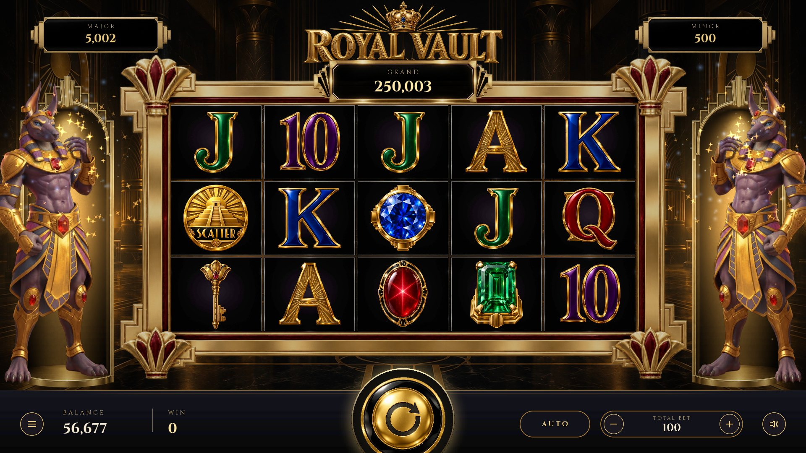 | 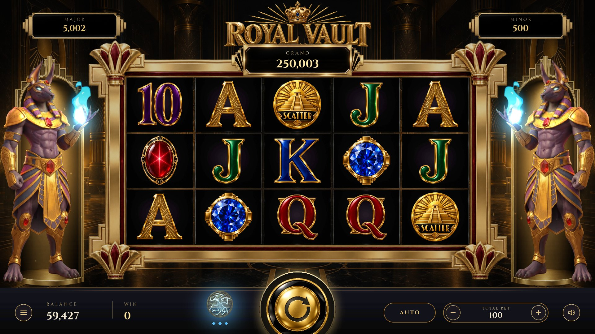 |

## Symbols that come alive

Every symbol celebrates in its own way (`SymbolStyle` on the theme): card royals pop as a band of light sweeps across
their metal, gems sway in a coloured glow with twinkling stars, treasures shed gold dust, the wild flashes with rays
turning behind it, the seal glows with the vault's blue light and the crown glints with jewel colours. The sweep and
flash are drawn by a small shader (`RoyalVault/UI Symbol`) so they stay inside each symbol's shape; rays, stars and
dust come from `SymbolFxLayer`, drawn outside the reels' masks so nothing is cut at a reel's edge. The wild, seal and
crown thump with a ring of light as they land, and at rest a gem, crown or wild catches a glint now and then. A
symbol can also carry baked win frames (`winAnimation`, for example from a Keyframe.it or Spine export), which play
instead of the built-in pulse.

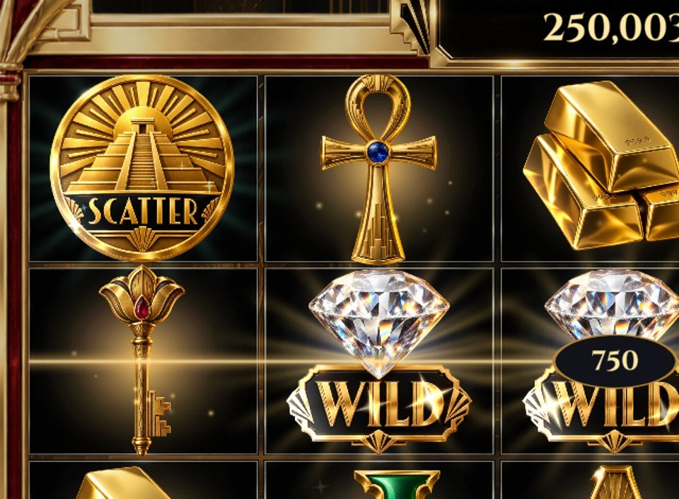

## Sound

The game's sound is data and plumbing, ready for any sound pack. A `SoundBank` ScriptableObject
(`Data/RoyalVault_Sounds.asset`) lists every moment as a `SoundCue` (buttons, reel spin and stops, wild / seal / crown
landing, seal cracks and break, small and big wins, jackpots, coin shower, free spins, story pages, the guardians'
flame) plus three music loops (loading, base game, free spins). Each cue takes several clips (one plays at random), a
volume and a pitch variance; an empty cue is silent. `SoundPlayer` plays it (a pool of effect channels, looping
effects, music that cross-fades) and keeps the player's mute between sessions; `SoundDirector`, added by the
composition root, listens to the events the game already has and asks for the right cue, so no view knows about
sound.

To add a pack, drop its files anywhere under `Assets/RoyalVault/Art.Private/Audio/` (git-ignored, like the licensed
art) and run **Royal Vault > Build All**: files are filled in by name.

| File name starts with | Goes to |
|---|---|
| `Music_Loading`, `Music_Base`, `Music_FreeSpins` | the music loops |
| a cue's name, e.g. `ReelStop_01`, `ReelStop_02`, `BigWin`, `SealCrack` | that cue (every match is a variation) |

Clips assigned by hand in the Inspector are kept, and a newly filled cue starts at a sensible place in the mix.
Music imports as streaming Vorbis, effects decompressed on load.

The effects currently come from Game Sound Planet's free "Strictly Slots" starter pack (not in this repository; see
`Art.Private/Audio/GameSoundPlanet/SOURCE.txt` locally for which file fills which cue). The music is CC0 from
OpenGameArt: "Desert Mystic" by PolygonDan on the loading screen and its stronger version in free spins, and "Desert
Loop" by iamoneabe in the base game (also kept in `Art.Private/Audio`).
The `SoundTests` PlayMode tests spin forced outcomes and check that every moment reaches the player.

## Testing the look and feel

- **Win showcase:** tick *Showcase Wins* on the `GameBootstrap` (the RoyalVaultGame prefab) and every paid spin lands
  the next result in *Showcase Order*: line win, big, mega and epic wins, free spins, and each jackpot tier, then
  round again. It fakes nothing: `WinShowcase` searches for reel stops whose real outcome, by the normal rules, is that
  result. A toast names what is coming, free spins play out at random, and credits are not saved while it is on at
  start. It can be ticked or unticked while playing.
- **Reel order:** on the `MachineView`, *Start Order* and *Stop Order* are each **Sequential**, **Random** (a new order
  every spin) or **All At Once**, with the gap between reels for each. Every reel runs exactly its scheduled time: the
  part of a lap needed to reach its target symbol is made up by one jump along the strip while it is a motion blur, so
  reels land in exactly the order asked for.
- **Anticipation:** when the landed reels are one Vault Seal short of free spins (or one crown short of a jackpot),
  every reel still to land spins longer, one by one, inside a frame of light with sparks rising, while the guardians'
  flames flare and the anticipation loop plays. It reacts only to what has landed, so it can end in a miss. Toggle and
  timings are under *Anticipation* on the `MachineView`; there is none when every reel lands at once.
- `ShowcaseTests` (PlayMode) spins every showcase result and checks it, and spins all nine start / stop order pairs
  checking that every cell shows what the engine decided.

| Epic win | Grand jackpot | Anticipation |
|---|---|---|
| 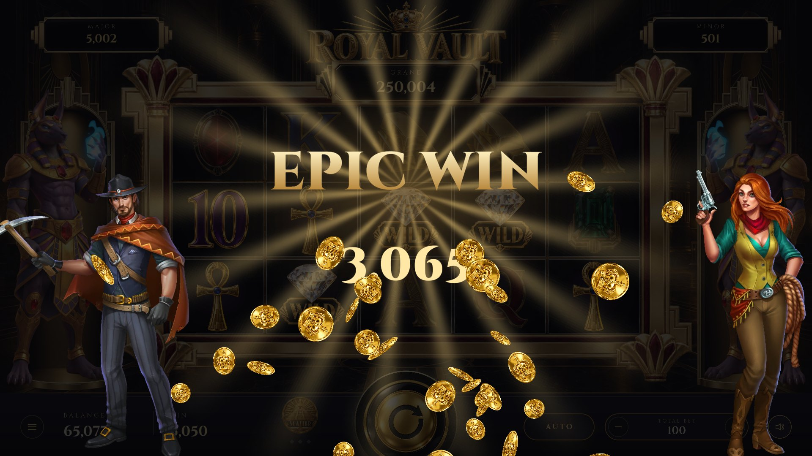 | 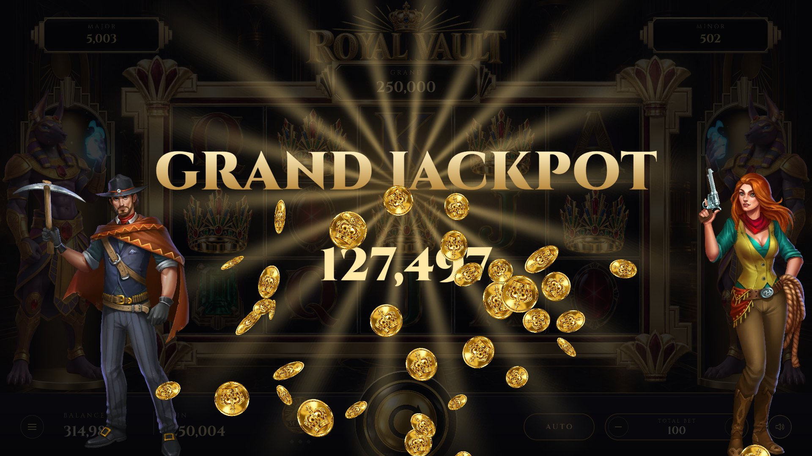 | 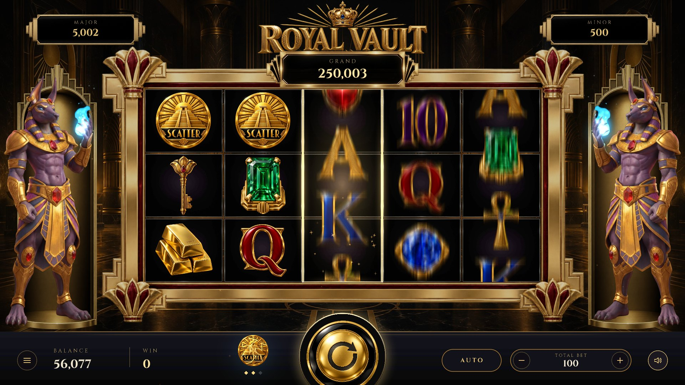 |

## The story

**Gold Rush to the Pharaoh's Vault.** A prospector, Cole Harlan, and a sharpshooter, Ruby Vance, follow a map out of
the Wild West into a buried pyramid, where the Anubis guardians judge whether they leave rich. The story is data: a
`StoryDefinition` ScriptableObject holds six scenes (backdrop, characters, title, caption) and the game moment that
tells each one. The loading screen tells the intro (chapters I and II) the first time the game starts, with a slow
camera push. The first launch tells it as a letterboxed cinematic paced by the player: each chapter types out beat by
beat, the heroes step in, "Skip story" is always there and the last page ends on **Enter the Vault**, while the game
loads underneath. Later starts show only the last intro scene behind the loading bar.

In play, `StoryDirector` tells each later chapter once, at its moment: chapter III on the first visit (followed by
hints that spotlight the spin button, the seal meter and the jackpots), IV when the seal first breaks, V and VI on the
first Major and Grand jackpots. `TypewriterText`, `ChapterCardView` and `CoachMarkView` are small reusable pieces.

| Enter the Vault | Chapter III in play | First-visit hint |
|---|---|---|
| 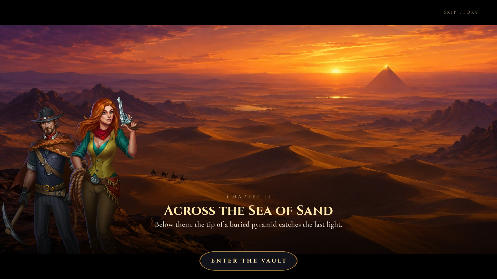 | 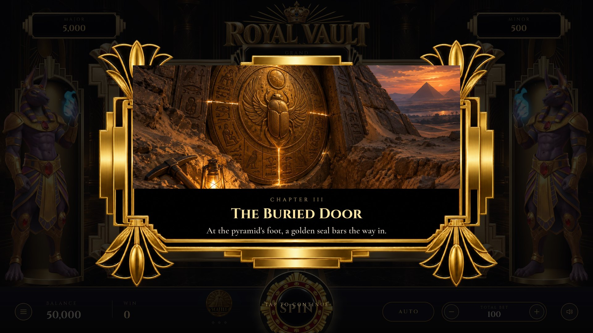 | 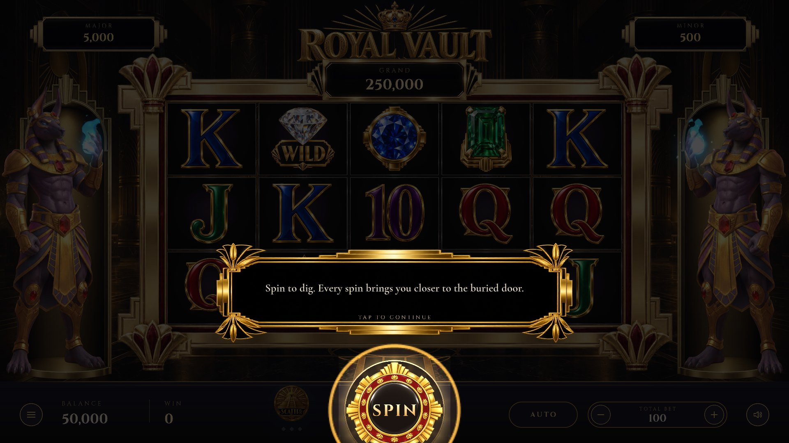 |

| Chapter I | Chapter II |
|---|---|
|  | 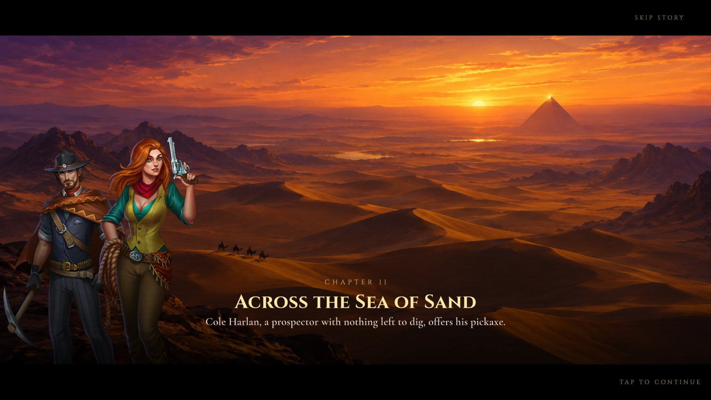 |

### The seal meter

The story's golden seal sits beside the spin button. As the reels land, every Vault Seal cracks it a little more
(light leaks through the cracks, sparks fly, a pip lights); when enough land for free spins it shatters and the vault
stays open, glowing blue, for the whole round, and the next paid spin mends it. `SealMeterView` listens to the reels
landing one by one (`MachineView.ReelStopped`) and only shows what the spin already decided, so the maths and RTP
are unchanged.

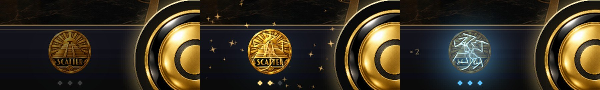

### The guardians' flame clash

Before a big win or jackpot is announced, both Anubis lean and step towards the reels, call up their flame and hurl
it: two blue fireballs with spark trails arc in and meet at the centre of the screen in a flash, shockwave rings and a
spray of blue and gold sparks, with a jolt through the machine, and then the celebration opens. `FlameClashView` plays
it (toggle, meeting point and flight time in the Inspector); the guardians' `WindUp` / `Release` lean them in, wait
for the flame to be up in the hand and recoil as it leaves. It is skipped in quick spins (auto play, free spins).

| The throw | The clash |
|---|---|
| 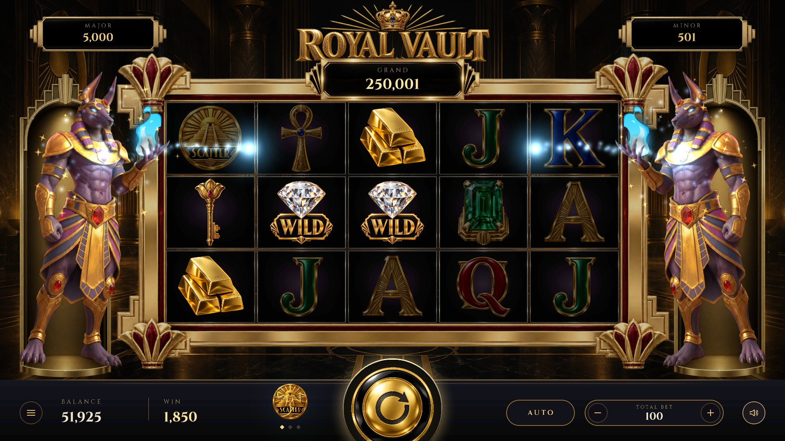 | 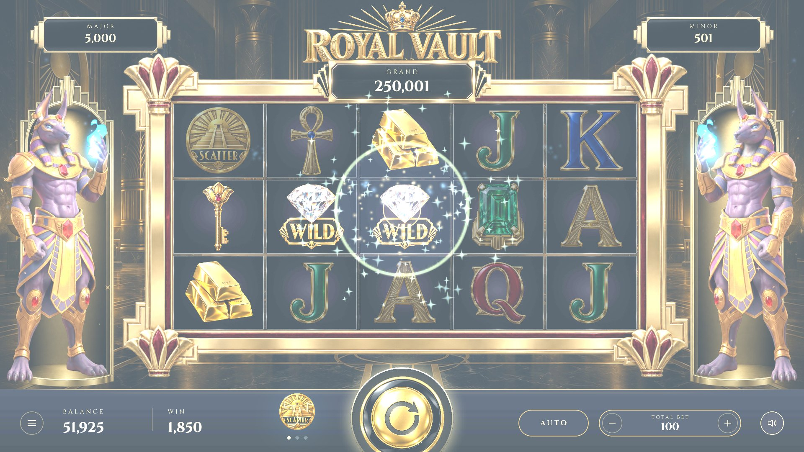 |

### The heroes celebrate

On big wins, jackpots and the free spin cards, Cole and Ruby stride in at either side of the banner and play their
action for as long as the celebration lasts: he shoulders his pickaxe, she spins her revolver. Their skeletal
animations are baked to frames like the guardians' (`CharacterAnimation`, set on the theme as `heroLeft` and
`heroRight`); without them the celebration plays as before.


## Running it

- Unity **6000.3.10f1** (Unity 6.3). Open the project, open `Assets/RoyalVault/Scenes/Boot.unity` and press Play.
  Boot shows the loading screen and switches to the Game scene by itself.
- `Game_Classic3x3.unity` is the same game prefab playing the 3 x 3 machine.
- **Royal Vault > Build Everything** regenerates the fonts, generated textures, theme, prefab and scenes after you
  change art or presets. Machine assets that already exist are kept, so balancing done in the Inspector survives.

## How it is built

```
GameBootstrap  (single entry point: reads the assets, builds Core, hands it to the views)
   │
   ├── Core  (plain C#, no Unity references: RoyalVault.Core.asmdef has noEngineReferences)
   │     MachineDefinition ─► SpinEngine ─► WinEvaluator [PaylineRule, ScatterRule, JackpotRule] ─► SpinOutcome
   │     GameSession [Wallet, BetModel, JackpotPool, FreeSpinState] ◄── ISaveStore
   │     SpinFlow ─► FeaturePipeline [FreeSpins, Jackpot, WinTier, AutoPlay]   (ISlotFeature plug-ins)
   │
   └── Unity  (presentation only: shows what Core decided, never decides itself)
         MachineView ─► ReelView ─► SymbolView, PaylineView
         WinPresenter, BigWinView, JackpotPanelView, ConsoleView, SpinButtonView, CharacterView, PaytableView
         RoundController  (console presses → flow requests; flow events → reel spins and win shows)
```

- **Data, not code.** A machine is a `MachineDefinitionAsset` (ScriptableObject): grid size, symbols, reel
  strips, paylines, pays, scatter and jackpot rules, bets. The look is a `ThemeDefinition` (ScriptableObject):
  symbol art by id, machine and UI sprites, fonts, colours and the reel area.
- **A 3 x 3 game** is a different machine asset. `MachineView` sizes the cells to the theme's reel area for any
  reels × rows and the 9-slice frame wraps the result.
- **A reskin** is a different theme asset.
- **New gameplay** is a new `ISlotFeature` (hooks: `OnSpinRequested`, `OnOutcome`, `OnPaid`) added to the
  pipeline in `GameBootstrap`; the engine and flow do not change. `FlowTests.NewFeature_PlugsInWithoutChangingTheFlow`
  shows a three-line example.
- **Outcomes are decided before anything moves.** `SpinEngine` picks the stops; `ReelView` only animates to them.
- **Drag and drop.** `Prefabs/RoyalVaultGame.prefab` is the whole game; drop it in a scene, set its machine and
  theme, press Play.

### Editor tools

- **Royal Vault > Build Everything**: fonts, generated textures, presets, theme, prefab, Boot and Game scenes.
- **Machine asset inspector**: validates the machine and simulates 1,000,000 paid spins to report the RTP.
- **ArtImporter**: sprite settings and 9-slice borders on first import.

## The maths

Reel strips and pays were tuned by simulation and are checked by the tests (1,000,000 paid spins each):

| Machine | RTP | Hit rate | Free spins | Jackpots |
|---|---|---|---|---|
| Royal Vault 5 x 3 | about 95.5 % | 27.5 % | 1 in about 470 spins (8 / 12 / 20 at x2) | Minor 3, Major 4, Grand 5 crowns |
| Classic 3 x 3 | about 96.4 % | 10.9 % | 1 in about 690 spins (6 at x2) | Minor 3 crowns |

## Tests

- EditMode (`Assets/RoyalVault/Tests/EditMode`): engine and win rules, the spin flow and features, saving, a
  plug-in feature, and the RTP of both machines.
- PlayMode screenshot run: `ROYALVAULT_SHOTS=/some/folder Unity -batchmode -projectPath . -runTests -testPlatform PlayMode -testFilter CaptureScreens`
  boots the game and captures every screen (the images in `docs/screenshots`).

## Art and fonts

- The Royal Vault art (symbols, frame, logo, buttons, plaques, backgrounds) was generated for this project with
  Figma AI and finished by hand; the vignette, glow, payline, light rays and console buttons are drawn in code by
  the builder.
- Fonts: [Cinzel](https://fonts.google.com/specimen/Cinzel) and
  [Cormorant Garamond](https://fonts.google.com/specimen/Cormorant+Garamond), SIL Open Font License
  (`Assets/RoyalVault/Fonts/OFL-*.txt`).
- The Anubis guardians are licensed art (Retro Style Games, Crowns of Kemet) and are **not** in this repository
  (`Assets/RoyalVault/Art.Private` is git-ignored, including their baked animation frames). Without them the game
  runs with empty niches.
- The story's prospector and sharpshooter are licensed art as well and live in `Art.Private` (with their baked
  frames); without them the story is told over the painted backdrops alone and the celebrations play without them. The backdrops (`Art/Story`) were painted for this game with Figma AI.

## Licence

No licence has been chosen yet, so all rights are reserved: you may read the code here but not reuse it.
